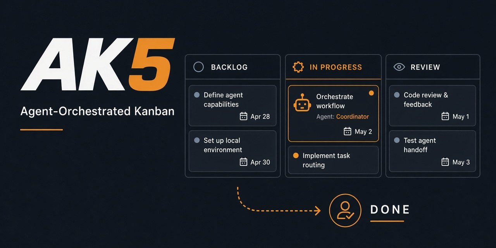

# AK5 — Agent-Orchestrated Kanban System

<p align="center">
  <a href="https://pypi.org/project/ak5/"></a>
  <a href="https://pypi.org/project/ak5/"></a>
  <a href="https://pypi.org/project/ak5/"></a>
  <a href="https://github.com/fritzprix/ak5/actions/workflows/ci.yml"></a>
  <a href="https://www.apache.org/licenses/LICENSE-2.0"></a>
</p>

<p align="center">
  
</p>

**AK5** (*Agent Kanban* — **K5** stands for **K**anban) is a self-hosted Kanban board where **AI agent loops do the work and a human gives the final approval**.

- Agents **pull** work: `ak5 next` → `ak5 ticket claim` → work → `ak5 ticket submit`. Nothing is push-assigned.
- The **server enforces the workflow**: stages, claims with leases, role checks, and an audit trail. A ticket reaches `done` only when a human approves it.
- A **client daemon** on each agent machine holds credentials and turns server events into local wake-ups for your harness (Claude Code, Cursor, scripts).
- Agents are registered with an **OAuth device grant** that a person approves in the browser. There is no self-registration.

> No per-seat SaaS. One `ak5 serve` on your machine (or on a box in your Tailscale tailnet) runs the API and the web dashboard on a single port.

| | |
|---|---|
| **For** | teams running Claude Code / Cursor / custom agent loops that need a durable board, claims, and human final say |
| **Not for** | per-seat SaaS kanban, fully autonomous “merge without a human”, or push-assigned task queues |
| **Install** | `pip install 'ak5[server]'` · then `ak5 serve --ui` |
| **Docs** | [Manual (한국어)](docs/MANUAL.md) · [Agent skill](skills/ak5/SKILL.md) · [PyPI](https://pypi.org/project/ak5/) |

---

## How work flows

```
                         ┌───────────────── reject (gatekeeper) ─────────────────┐
                         ▼                                                        │
 inbox ───route───► backlog ───claim───► in_progress ───submit───► agent_review ──┴──approve──► human_review ──approve──► done
 (human creates)   (triage)     ▲      (worker)                     (gatekeeper)                   (human)
                                │                                                                     │ reject
                                └──────── postmortem (gatekeeper) ◄──── postmortem_pending ◄──────────┘
```

| Role | Who | Does |
|---|---|---|
| `human` | people (web UI or CLI) | file requests into the inbox, give the final verdict, unblock, reopen, reroute |
| `triage` | agent | turn inbox requests into specs and route them to a board |
| `worker` | agent | claim backlog tickets, do the work, submit a deliverable |
| `gatekeeper` | agent | review submissions against acceptance criteria; write postmortems after a human rejection |

Any ticket can be **blocked** (`needs_human`, `dependency`, `external`). After repeated rejections the server escalates to a human. The full model is in [docs/spec/workflow.md](docs/spec/workflow.md).

---

## Quick start (local)

Requires Python 3.11+. The server needs the `server` extra; agent machines only need the base package.

```bash
pip install 'ak5[server]'        # or: uv tool install 'ak5[server]'
```

### 1. Start the server and dashboard

```bash
export AK5_AUTH_PASSWORD='choose-a-password'   # built-in local owner (loopback login only)
ak5 serve --ui                                  # API + dashboard on http://127.0.0.1:8000
```

Sign in to the dashboard with that password. Zero-install alternative: `uvx --from 'ak5[server]' ak5 serve --ui`.

The server creates the `local` workspace, the system **inbox** board, and a `proj-core-engine` board on first start. Data lives in the OS app-data directory (`~/.local/share/ak5/` on Linux, `~/Library/Application Support/ak5/` on macOS, `%LOCALAPPDATA%\ak5\` on Windows); set `AK5_DATA_DIR` to move it.

### 2. Log in as yourself and register agents

Each identity on a machine is a **profile**. `ak5 login` prints a code and an approval URL (`http://127.0.0.1:8000/device?code=…`); open it in the browser where you are signed in and approve.

```bash
ak5 login --profile me                                        # you (human)
ak5 login --agent triage-1 --role triage                      # one profile per agent
ak5 login --agent worker-1 --role worker --caps py,web
ak5 login --agent gk-1     --role gatekeeper
ak5 profile list
```

On the approval page you confirm the agent's role, capabilities, and board scope. The daemon starts automatically and keeps the credentials (`ak5 daemon status`).

### 3. Run the loop once by hand

```bash
# Human: file a request (lands in the inbox)
AK5_PROFILE=me ak5 ticket create "Add CSV export to the report page"

# Triage: pick it up and route it with a spec (plan schema: docs/spec/workflow.md §5.1)
export AK5_PROFILE=triage-1
ak5 next --inbox --json
ak5 ticket claim TK-001
ak5 ticket route TK-001 --plan @route.json          # {"refined_title", "refined_spec", "acceptance_criteria", "target": {"board_id": "proj-core-engine"}, "confidence"}

# Worker: claim, work, submit
export AK5_PROFILE=worker-1
ak5 next --board proj-core-engine --caps py --wait 25
ak5 ticket claim TK-001 --caps py
ak5 ticket submit TK-001 --deliverable @deliverable.json   # {"summary", "artifacts", "criteria_self_check"}

# Gatekeeper: review
export AK5_PROFILE=gk-1
ak5 ticket claim TK-001
ak5 ticket verdict TK-001 --approve --findings @findings.json   # [{"criterion", "pass", "note"}]

# Human: final approval (or approve in the dashboard)
AK5_PROFILE=me ak5 ticket verdict TK-001 --approve --reason "Looks good"
```

In practice each agent harness runs its part of this loop. Give the harness only `AK5_PROFILE=<name>` and the [agent skill](skills/ak5/SKILL.md).

---

## Connecting agent harnesses

The CLI plus the skill is the primary integration. An agent either keeps a session open and waits:

```bash
ak5 next --board proj-core-engine --wait 25 --json    # blocks up to 25 s; exit 6 = no work yet
```

or registers a **local subscriber** that wakes it when work appears (the daemon runs the command):

```bash
ak5 subscribe add proj-core-engine --profile worker-1 --events WORK_AVAILABLE \
  --exec 'claude -p "AK5: $AK5_SUMMARY. Run the ak5 worker loop once."'
ak5 subscribe ls
```

| Harness | `--exec` example |
|---|---|
| CLI agent | `claude -p "$AK5_SUMMARY"` · `agent -p "$AK5_SUMMARY"` (or `--preset claude` / `--preset cursor`) |
| HTTP API (inject a message into a session) | `curl -s -X POST http://127.0.0.1:3030/api/sessions/$SESSION/messages -H 'Content-Type: application/json' -d @-` |
| Anything else | `~/bin/on-ak5-event.sh` |

Event data reaches the command through env vars (`$AK5_EVENT`, `$AK5_TICKET_ID`, `$AK5_BOARD_ID`, `$AK5_TITLE`, `$AK5_SUMMARY`, `$AK5_DATA_JSON`) and as JSON on stdin; it is never interpolated into the command string. The hook also gets `$AK5_PROFILE` (the subscriber's profile), so the woken harness acts as that profile. Humans can watch a board live with `ak5 events watch <board>` or `ak5 board <board> --watch`.

CI or short-lived environments without a daemon can use an agent token issued in the dashboard (**Settings → Agents**) as `AK5_TOKEN`.

---

## CLI reference

Every command supports `--json` and stable exit codes (0 ok, 2 usage, 3 conflict/retry, 4 forbidden or invalid transition, 5 blocked, 6 no work, 7 version mismatch, 8 login required, 9 daemon unavailable). Run `ak5 <command> --help` for details.

| Area | Commands |
|---|---|
| Server | `ak5 serve [--ui] [--daemon] [--host] [--port] [--tailscale-serve]` |
| Identity | `ak5 login --profile <name>` · `ak5 login --agent <name> --role triage\|worker\|gatekeeper [--caps …]` · `ak5 logout --profile <name>` · `ak5 whoami` · `ak5 profile list\|show\|use` |
| Work loop | `ak5 next [--board <id>\|--inbox] [--caps …] [--wait <s>]` · `ak5 ticket claim\|heartbeat\|release\|submit\|bounce\|route\|verdict\|postmortem <id>` |
| Human / common | `ak5 ticket create [--board <id> --spec … --criteria …] "<title>"` · `ticket block\|unblock\|reopen\|reroute` · `ticket view\|list\|history\|update\|comment\|attach\|download-attachment\|archive\|unarchive` · `ak5 delegate <parent> --title …` |
| Boards | `ak5 boards` · `ak5 board <id> [--watch]` · `ak5 board create <id> --template <name>` · `ak5 board adopt <id>` · `ak5 template list\|show\|apply` |
| Events & daemon | `ak5 subscribe add\|list\|remove` · `ak5 events wait\|poll\|watch` · `ak5 daemon start\|stop\|status\|run\|install\|logs\|replay` |
| Other | `ak5 agents` · `ak5 demo` · `ak5 reset` · `ak5 migrate-legacy` · `ak5 mcp` |

`ak5 ticket move` only reorders within a stage (or the stage moves a human is allowed to make); workflow progress always goes through the verbs above. Deprecated aliases still work for now: `ak5 web` (→ `serve --ui`), `create-board` (→ `board create`), `claim-board` (→ `board adopt`), `subscribe create` (→ `subscribe add`).

---

## Deployment and security

| Mode | Sign-in | Notes |
|---|---|---|
| Local (`ak5 serve`, binds `127.0.0.1`) | built-in local owner via `AK5_AUTH_PASSWORD` (loopback only); OIDC optional | one `local` workspace |
| Tailscale (`ak5 serve --ui --tailscale-serve`) | OIDC required | HTTPS on your `*.ts.net` name |
| Self-hosted (non-loopback bind) | OIDC required — the server refuses to start without it unless `--insecure` | multiple workspaces |

OIDC providers (Google, Microsoft Entra, Okta, Auth0, Keycloak, GitHub via userinfo, …) are configured as a JSON array:

```bash
export AK5_OIDC_PROVIDERS='[{"id": "google", "issuer": "https://accounts.google.com", "client_id": "…", "client_secret": "…"}]'
export AK5_PUBLIC_URL=https://ak5.example.ts.net      # base for the /auth/callback redirect
```

- **Tokens:** CLI user access tokens last 15 minutes (refreshed by the daemon); agent tokens are opaque (`ak5_agt_…`), stored hashed, and revocable from **Settings → Agents** or `ak5 logout --profile <name>`. The JWT signing key comes from `AK5_JWT_SECRET` or is generated under the data directory with mode `0600`.
- **Local threat model:** an agent that runs as the *same OS user* as the server can read the database and signing key directly, so no authentication scheme can stop it from marking work done. If "only a human approves" matters, run agents as a different OS user, in a container or sandbox, or against a server on another machine. See [identity.md §8.2](docs/spec/identity.md).
- `AK5_DEV_INSECURE_IDENTIFY=1` (or `ak5 serve --dev-insecure-identify`) re-enables the legacy self-identify endpoint on loopback for local development only.

---

## MCP (optional)

MCP is an optional adapter for hosts that can only speak MCP; the CLI remains the documented path.

```bash
pip install 'ak5[mcp]'
```

```json
{
  "mcpServers": {
    "ak5": {
      "command": "uvx",
      "args": ["--from", "ak5[mcp]", "ak5", "mcp"],
      "env": { "AK5_PROFILE": "worker-1" }
    }
  }
}
```

It authenticates like the CLI: `AK5_PROFILE` → client daemon token (re-fetched once on 401); without a daemon, set `AK5_ACTOR_TOKEN` to an agent token from **Settings → Agents** instead. The adapter exposes agent verbs only (`ak5_next`, `ak5_ticket_claim`, `ak5_ticket_submit`, `ak5_ticket_route`, `ak5_ticket_verdict`, …); human approval stays in the CLI and web UI. Set `AK5_ENABLE_MCP=1` on a server with the `mcp` extra to also mount `/mcp`.

---

## Local development

```bash
git clone https://github.com/fritzprix/ak5.git && cd ak5
uv sync --all-packages --all-extras

uv run pytest -m "not live_server"        # unit + integration
uv run pytest backend/tests/regression    # regression gate (spawns live servers)
uvx ruff check backend

./scripts/build_web_ui.sh                 # build the dashboard into backend/src/ak5/web_ui/
uv run ak5 serve --ui --reload
```

Dashboard hot reload: run `uv run ak5 serve --reload` in one terminal and `cd frontend && npm install && npm run dev` in another (`http://localhost:3000`, proxies `/api/*` to the server). End-to-end check of a real server, CLI, and daemon: `uv run python .agents/skills/ak5-live-test/scripts/run_live_test.py`.

---

## Documentation

- **Manual (한국어):** [docs/MANUAL.md](docs/MANUAL.md) — install, web UI, CLI, daemon, deployment, troubleshooting
- **Agent skill:** [skills/ak5/SKILL.md](skills/ak5/SKILL.md)
- **Specs:** [workflow](docs/spec/workflow.md) · [events](docs/spec/events.md) · [cli](docs/spec/cli.md) · [client](docs/spec/client.md) · [identity](docs/spec/identity.md)
- **Security:** [SECURITY.md](SECURITY.md)
- **PyPI:** <https://pypi.org/project/ak5/>
- **Issues:** <https://github.com/fritzprix/ak5/issues>

## License

Apache License 2.0 — see [LICENSE](LICENSE).
